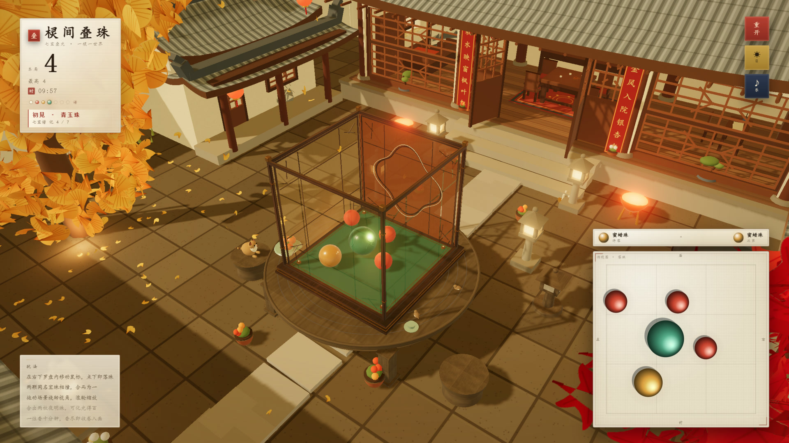
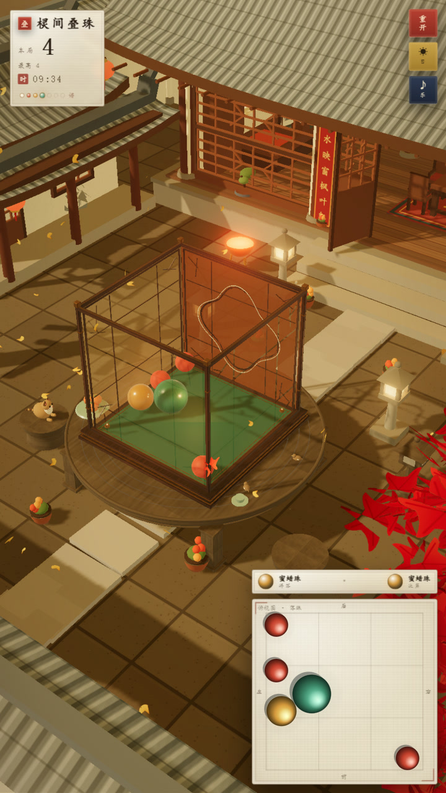
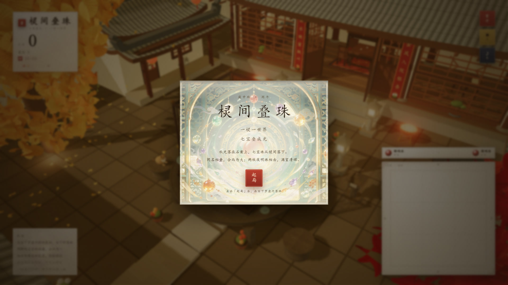

# 棂间叠珠 · 七宝叠光

> 一院秋光，一张石桌，一只紫檀棂笼。七宝珠从棂间落下，同名相叠；两枚夜明珠相击，满院清辉。

一个国风 3D 合成小游戏：在紫檀棂笼中落珠、合成七宝，最终合出两枚夜明珠并让它们「化光」。基于 **Three.js** 渲染 + **cannon-es** 刚体物理，纯前端、无后端；除一张「福」字影壁贴图外无外部美术资产。



---

## 一、参赛信息

> 以下信息请在「完整版」提交前补齐；「匿名版」请删除本表与任何个人信息。

| 项目 | 内容 |
| --- | --- |
| 队伍名称 | 待填写 |
| 参赛组别 | 待填写（零组 / 壹组） |
| 队长 | 待填写 |
| 组内成员 | 待填写 |
| 作品名称 | 棂间叠珠 |
| 作品类型 | 游戏网站 · 3D 合成解谜 |
| 界面规格 | **自适应**：1920×1080 / 1440×900 / 720×1280（同时适配） |
| 运行环境 | Chrome 129+，WebGL 2 |

---

## 二、玩法与操作

七种宝珠由小到大：**砗磲珠 → 珊瑚珠 → 蜜蜡珠 → 青玉珠 → 琉璃珠 → 紫晶珠 → 夜明珠**。

- **落珠**：在右下角「俯视图 · 落珠」罗盘内移动鼠标，点下即在对应位置落珠；罗盘与盒顶坐标一一对应。
- **合成**：两颗同名宝珠相撞，于中点合成大一号宝珠；两枚夜明珠相击则「双珠化光」，奖励 100 分。
- **视角**：在罗盘外的场景中按住拖动旋转视角，滚轮缩放。
- **开场镜头**：点「起局」后，镜头从院外全景推近大门 → 两扇门徐徐开启 → 绕过迎门影壁、穿过月洞门 → 在院内升起并对准石案；镜头落位后才允许落珠。
- **重开**：右上角朱印「重开」清空重来；最高分保存在本地。
- **匣满**：珠子堆到盒口以上并静止一段时间，本局结束，展开「匣满」卷轴。
- **漏刻**：左上角显示两分钟倒计时（`ROUND_SECONDS`），最后 30 秒转为朱红闪烁；香尽则以「漏尽香销 · 收卷」收局，同样落到那幅水墨卷轴上。两种收局都停表，只能「再开」。
- **队列**：罗盘上方显示「将落 / 次第」两枚宝珠，每落一珠从 1~3 号中补一枚。

| 桌面 | 移动端 |
| --- | --- |
|  |  |

---

## 三、美术方向

- **场景**：中式庭院（移植自独立的「庭院秋夜」微缩场景，整体放大 2 倍以拉开建筑与石案的尺度）。院墙与大门、月洞门、正房与厢房、石径、枫树/银杏/竹丛、太湖石、水缸、夜灯、落叶、烟与尘；`UnrealBloomPass` 让灯火与珠光溢出。
- **门口石狮**：大门两侧门枕石上蹲一对石狮，程序化建模（须弥座、敦实的后胯与前胸、直立前腿分三趾、两圈卷毛鬃、压低的眉与小眼、翘起的卷尾），左雄踏绣球、右雌抚幼狮，头略向门外侧转，面朝街外。
- **时段**：默认白天（`config.ts` 的 `TIME_OF_DAY`），右上角「日 / 夜」朱印可随时切换并记在 localStorage。白天为蓝天 + 低挂太阳 + 西南暖阳主光 + 天空环境反射（灯火自动调暗、星星隐藏、Bloom 减弱）；秋夜为深蓝天幕 + 星 + 低垂满月 + 灯火与 Bloom。
- **开场运镜**：院外全景 → 推近「听秋别院」大门 → 门扇开启 → 绕过迎门「福」影壁 → 穿月洞门 → 院内升起对准石案；位置用 Catmull-Rom 曲线串起，视线单独用一条曲线引导。
- **保留的石案一组**：石桌（含两只石凳）、石灯笼与桌上柿子/茶盏沿用原建模，仍摆在庭院中心，棂笼坐在石桌面上。
- **容器**：紫檀「棂笼」。四角立柱、铜包角、绢纱、井字棂条、后壁海棠开光与描金环、内灯与须弥座；近面绢纱与棂条会随视角淡出，保证永远看得见珠堆。
- **七宝珠**：程序化材质——砗磲的珠光、珊瑚的哑光、蜜蜡的流纹、青玉的冰裂、琉璃的金箔、紫晶的晶面、夜明珠的自发光与光晕。
- **庭院生灵**：石凳上蹲一只狸花猫（呼吸、甩尾、眨眼，夜里双眼透琥珀光），桌沿歇两只小鸟，入夜后院中浮起一串萤火（自定义 shader 的 `Points`，按画质 24/16/10 只）。全部程序化建模，无外部模型资源。
- **匣满化光**：珠堆溢出触发终局时，先让盘中珠化作光点升起、旋散并留下一圈金环，再展开「匣满」卷轴；卷轴底纹是一幅水墨山水画（`src/assets/ink-scroll.png`：远山、飞鸟、红日、小舟），按卷轴实际画幅铺排、画面中部压一层宣纸雾保证正文可读，图片未解码时退回 Canvas 现画的淡墨山脊兜底。时辰走空时是同一幅卷轴，题作「漏尽香销 · 收卷」。
- **最后十秒**：屏幕四周泛起残阳红晕并按 1s 心跳呼吸，同时每秒一声短促木鱼（末三秒更高更响），提醒香将尽。
- **界面**：宣纸、墨线、朱砂印、描金细边；卷轴开场、罗盘俯视图、七宝谱。
- **起局卷轴**：卷面底纹是「棂间七宝」画（`src/assets/intro-art.png`，棂格拱门 + 七宝珠 + 云纹莲影），`background-size: cover` 铺满卷面，再叠一层「中浓边淡」的宣纸雾与上下渐隐，正文压上去依旧清楚。
- **光**：月光主光（冷）+ 天光半球光 + 檐下暖灯与笼内灯；另给石案补一盏柔和顶光，保证石桌/石凳/石灯在夜色里仍可读。



完整美术方案见 [docs/art-direction.md](docs/art-direction.md)。

---

## 四、技术栈与非自研库清单

### 运行环境

- Node.js ≥ 20.19（开发/构建）
- Chrome 129+，支持 WebGL 2

### 非自研库（均为功能性库，不使用任何预设样式库）

| 库 | 版本 | 用途 | 说明 |
| --- | --- | --- | --- |
| [three](https://threejs.org/) | 0.187.0 | WebGL 3D 渲染 | 几何体、PBR 材质、阴影、后期、程序化纹理载体 |
| [cannon-es](https://github.com/pmndrs/cannon-es) | 0.20.0 | 刚体物理 | 球体堆叠、碰撞、重力与接触解算 |
| [Vite](https://vitejs.dev/) | 8.3.5 | 开发服务器 / 构建 | 仅开发与构建期使用 |
| [TypeScript](https://www.typescriptlang.org/) | ~7.0.2 | 类型检查 / 编译 | 仅开发与构建期使用 |
| [@types/three](https://www.npmjs.com/package/@types/three) | 0.187.0 | three.js 类型声明 | 仅开发期使用 |

**未使用**：Bootstrap、Tailwind、Vue/React UI 组件库、任何预设样式库或游戏框架的现成游戏模块。UI 的 HTML / CSS / Canvas 2D 全部手写。

> three.js 与 cannon-es 均为 MIT 许可；Vite 为 MIT 许可；TypeScript 为 Apache-2.0 许可。

### 外部资产

三张，均为用户提供的素材（经 Vite 打包后带 hash 引用）：

- `src/assets/fu-yingbi.png`（454×437）：迎门影壁的「福」字。
- `src/assets/ink-scroll.png`（584×306）：匣满 / 收卷卷轴的水墨山水底纹。
- `src/assets/intro-art.png`（768×387）：起局卷轴的「棂间七宝」底纹。

其余全部程序化：庭院、粉墙、瓦顶、月洞门、枫树、竹丛、石桌石凳、棂笼、七宝珠、猫与鸟、纹样、光斑、光晕与落叶全部由代码生成；音效由 Web Audio 实时合成；字体使用系统楷体/宋体回退，不下载外部字体。

---

## 五、技术亮点

1. **真 3D 堆叠**：cannon-es 刚体球在立方体容器中受重力堆叠；同号碰撞在中点合成。针对高速穿透做了固定子步、位置硬约束、限速与安全网四层防护（`scripts/physics-check.mjs` 离线回归 8 项不变量）。
2. **全程序化美术**：Canvas 生成石板、瓦面、木纹、绢纹、冰裂纹法线、蜜蜡流纹、金箔、树皮、枫叶、牌匾与夜空；`PMREMGenerator` 从程序化「月夜天空」烘环境反射，不引入 HDR。
3. **庭院与棂笼建模**：`ShapeGeometry` 挖月洞门、`ExtrudeGeometry` 做海棠开光与棂条、`RoundedBoxGeometry` 做木框铜角与石桌腿；四面棂格按视角淡出，暖色绢面与描金海棠环把珠堆衬出来。庭院环境与石案分成两个模块装配，便于替换场景而保留道具。
4. **俯视图与 3D 同源**：罗盘内 Canvas 2D 使用与点击映射同一套世界坐标；球影、光晕与主光方向一致；7.5% 内边距与 CSS 网格严格对齐。
5. **画质分级**：按设备能力自动选择高/中/低：阴影贴图、透光、粒子与落叶数量逐级降档；夜间庭院的月光阴影贴图同样按档位取值。
6. **完整的游戏流程**：开场卷轴、起局镜头（全景 → 开门 → 入院 → 入位）、落珠冷却、合成、匣满判定、重开、最高分本地持久化。
7. **可维护的分层**：`src/art/` 按色板、纹理、材质、珠体、棂笼、夜庭院、石案、特效、画质拆分；物理与合成逻辑独立在 `main.ts`。

---

## 六、快速开始

```bash
npm install
npm run dev        # 开发预览，默认 http://localhost:5173
npm run build      # 类型检查 + 生产构建（dist/）
npm run preview    # 预览生产构建
npm run test:physics
```

> 若 5173 被占用，可 `npm run dev -- --port 5180`。

---

## 七、项目结构

```
├── index.html                 页面骨架：HUD / 罗盘 / 卷轴
├── public/                    图标：favicon-32.png / favicon-192.png / apple-touch-icon.png
├── docs/
│   ├── art-direction.md       美术设计方案
│   └── screenshots/           README 截图
├── scripts/
│   └── physics-check.mjs      离线物理回归测试
└── src/
    ├── art/
    │   ├── palette.ts         色板
    │   ├── noise.ts           确定性随机
    │   ├── textures.ts        程序化贴图
    │   ├── materials.ts       紫檀 / 古铜 / 绢 / 七宝材质
    │   ├── pearls.ts          七宝珠几何与光晕
    │   ├── lantern.ts         棂笼、须弥座、内灯
    │   ├── nightCourt.ts      秋夜庭院环境（夜空/院墙/正房/厢房/树/夜灯/落叶/烟尘 + Bloom）
    │   ├── stoneSet.ts        保留的石桌、石凳、石灯笼与桌上摆件
    │   ├── fx.ts              涟漪、金粉、光丝、化光
    │   └── quality.ts         画质分级
    ├── audio.ts               WebAudio 合成音效
    ├── config.ts              等级 / 尺寸 / 物理常量
    ├── main.ts                物理、合成、落珠、俯视图、游戏流程
    ├── scene.ts               渲染器、相机、后期、装配
    └── style.css              国风 UI 与响应式
```

---

## 八、原创与合规说明

- 游戏名称、七宝体系、秋日庭院/棂笼的美术与建模、UI 版式、文案与音效均为本作品原创实现。
- 所有 3D 模型均由 three.js 几何体在运行时生成，不使用任何外部模型、贴图、HDR 或音频文件。
- 仅使用上表中列出的功能性库；未使用任何预设样式库，也未使用游戏框架中现成的游戏功能模块。
- 物理原型与手感在本项目内独立调校；`scripts/physics-check.mjs` 为自写回归测试。
- 若需匿名评审，请删除「参赛信息」表及 README 中的个人信息，并另附匿名版作品介绍。

---

## 九、已知限制

- 需要 WebGL 2；极旧设备或禁用硬件加速的浏览器无法运行。
- 移动端以点击落珠为主，未实现多指手势；界面为触控做了响应式适配。
- 最高分仅存于 `localStorage`，无后端与账号系统。
- 高画质（透光 + 2048 阴影）在低端设备上会自动降到中/低画质。

---

## 十、致谢

- [three.js](https://threejs.org/) 与 [cannon-es](https://github.com/pmndrs/cannon-es) 提供了稳定的渲染与物理基础。
- 视觉母题取自中式庭院、紫檀多宝格、冰裂纹窗与七宝意象；所有纹样均为程序化再创作。
